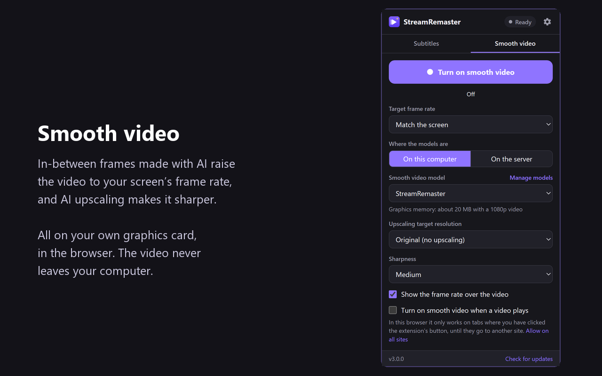

# StreamRemaster

**Live subtitles and smooth video for any browser tab, on your own hardware.**

Watch a Twitch stream, a YouTube video or a call in a language you don't speak, and read it
in yours, in real time. The audio never leaves your network: it goes only to the
[WhisperLive](https://github.com/collabora/WhisperLive) server you run, or it is transcribed on your own
graphics card and never leaves your computer. The **Smooth video** tab raises
the frame rate of the video and upscales it with AI, on your own graphics card.

StreamRemaster was called Stream Transcription up to version 2.2.0. The subtitles work as before.

[Versión en español](README.es.md)


## Features

- **Subtitles on top of any page**: Twitch, YouTube, Kick, any `<video>`… They follow you to
  fullscreen, you can drag them anywhere, choose 1–4 lines and the text size.
- **Translation**: Whisper's own translation to English, or any of ~100 languages through the
  server's translator.
- **Any Whisper model, from the extension**: paste a Hugging Face name or link
  (`Systran/faster-whisper-large-v3`, a fine-tuned model for your language, a direct `.zip`…)
  and the server downloads it — converting normal *transformers* checkpoints to
  faster-whisper format automatically. Then pick it from a list. No paths, no terminal.
- **Fits small graphics cards**: an "int8" option halves the model's memory with the same
  text, the translator can run on the CPU, and if the model doesn't fit you get a clear
  **VRAM warning** instead of subtitles that silently freeze.
- **Save the subtitles** as an `.srt` file when you stop.
- **Transcribe on this computer**, with no server: Whisper runs in the browser on your graphics card
  (WebGPU). Download a model once in Settings (tiny, base, small, medium or large-v3-turbo, from
  Hugging Face) and the audio never leaves your computer. On this computer the subtitles can only be
  translated into English.
- **Smooth video**: in-between frames generated with AI raise the video's frame rate up to your
  screen's, and AI upscaling doubles its resolution. On your own graphics card, with no server.
  [More below](#smooth-video).
- **Check for updates** from the extension: it says whether a newer version exists, for the
  extension and for the server, and takes you to it. Only when you ask.
- Interface in English, Spanish, Catalan, Galician, Basque, Portuguese, French, German, Italian, Dutch, Polish,
  Russian, Ukrainian, Chinese, Japanese, Korean, Thai and Hindi; it follows the browser or can be picked in the settings.
- No accounts, no tracking, no analytics. Source code available (PolyForm Noncommercial).

| Popup | Settings · models |
|---|---|
|  |  |

## Smooth video



The **Smooth video** tab, next to **Subtitles** in the popup, makes the video on the page play more
smoothly and look sharper. It does two things with AI:

- **In-between frames.** A stream at 30 or 60 fps on a 144 Hz screen shows each frame several times. The
  extension generates the frames in between, so the video plays at up to your screen's frame rate.
- **Upscaling.** It doubles the resolution of the video, for example from 720p to 1440p.

It all runs in the browser, on your own graphics card, through WebGPU. This tab needs no server: it works
without the WhisperLive server, and the video never leaves your computer. It works in Firefox, Zen and
Chromium browsers (tested in Brave).


The controls:

- **The large button** turns it on and off for the current tab.
- **Target frame rate**: **Match the screen**, or a fixed value: 60, 75, 90, 100, 120, 144, 165, 180 or
  240 fps.
- **AI model**: **StreamRemaster**, the model built into the extension; any model you have added; or
  **None (no AI)**, which uses a plain cross-fade between frames and plain scaling.
- **Upscaling target resolution**: **Original (no upscaling)**, **Match the screen**, 1080p, 1440p or 4K.

While it is on, a meter on the page shows the frame rate you get and the video's own.

**Models.** In Settings → **Smooth video models** you can add model files (`.stmodel`, and the older
`.srmodel` and `.fimodel`) and pick one. The built-in model is marked **Built-in** and cannot be deleted.
A model file holds weights only, no code, and the extension checks it strictly before using it. How
StreamRemaster was made, on what data and with what limits: [model card](docs/MODEL.md).

**Limits.** You need a graphics card and a browser with WebGPU. The upscaling draws plausible detail that
was not in the original, so it is not the place to read small text you need to trust. Protected (DRM)
video shows as black to any extension and cannot be processed.

## Install the extension

- **Firefox** (and Zen, LibreWolf, Floorp…), free: [addons.mozilla.org](https://addons.mozilla.org/firefox/addon/stream-transcription/)
- **Chromium** (Chrome, Brave, Edge, Opera, Vivaldi…): download
  `streamremaster-chromium-<version>.zip` from the
  [latest release](https://github.com/javimentallab/StreamRemaster/releases/latest),
  unzip it, open `chrome://extensions`, turn on **Developer mode** and click
  **Load unpacked** on the unzipped folder.

**Updates.** Firefox updates the add-on from AMO by itself. In both browsers, **Check for
updates** (at the bottom of the popup, or in Settings → About) asks GitHub for the latest
release and, if there is a newer one, opens the page to get it: the add-on's page on AMO in
Firefox, or the release on GitHub in Chromium, where you unzip the new zip over the old folder
and press the reload icon in `chrome://extensions` (your settings are kept). The extension
never downloads code or replaces itself.

Then click the extension's icon, type your server's address (e.g. `192.168.1.10:9090`) and
**Connect**.

## Server

You need a WhisperLive server, ideally on a computer with an NVIDIA graphics card (small
models also run on the CPU). Two options:

### Option A — StreamRemaster server (recommended)

WhisperLive plus the patches that make everything in the extension work (model management,
switching models, int8, translator on the CPU, VRAM warnings). With Docker and the
[NVIDIA Container Toolkit](https://docs.nvidia.com/datacenter/cloud-native/container-toolkit/latest/install-guide.html):

```sh
git clone https://github.com/javimentallab/StreamRemaster.git
cd StreamRemaster/server
docker compose up -d --build
```

The first start downloads the default model (`Systran/faster-whisper-small`, ~0.5 GB). The
server listens on port **9090** and runs as an unprivileged user; models are kept in the
`models` Docker volume (an old `server/models/` folder is no longer used and can be deleted;
the models are downloaded again). Options in
`docker-compose.yml`:

| Variable | Default | What it does |
|---|---|---|
| `ST_DEFAULT_MODEL` | `Systran/faster-whisper-small` | Model downloaded and used by default |
| `ST_ALLOW_MANAGEMENT` | `1` | `0` = the extension can list models but not download or delete them |
| `ST_MAX_CLIENTS` | `4` | Simultaneous transcriptions |
| `HF_TOKEN` | — | For gated or private Hugging Face models |

Anyone who can reach the port can use the server (and, with management on, download or
delete models): keep it inside your network or behind a firewall.

### Updating the server

The server never updates itself. In the extension, **Settings → About → Check for updates**
says whether a newer release exists (servers from this version on report their own version).
To update, run this from the folder where you cloned the repository:

```sh
cd StreamRemaster
git pull
cd server
docker compose up -d --build
```

The models stay in the `models` volume and are not downloaded again. If you edited
`docker-compose.yml` and `git pull` refuses to run, run `git stash` before it and
`git stash pop` after it.

### Option B — plain WhisperLive

The extension also works with an unmodified WhisperLive server. You then type a model size
(`tiny`, `small`, `medium`, `large-v3`…) instead of choosing from a list, and the
model-management and performance options are not available.

## How much graphics memory?

| Model | VRAM (float16) | With "Save memory (int8)" |
|---|---|---|
| small | ~1 GB | ~0.6 GB |
| medium | ~2 GB | ~1.2 GB |
| large-v3 / turbo | ~4 GB | ~2.3 GB |

The translator adds ~0.7 GB on the GPU (or nothing, set to run on the CPU).

## Privacy

The extension sends the tab's audio **only** to the server address you enter, or nowhere when you
transcribe on this computer. **Smooth video** sends nothing: the video is processed on your own graphics
card. The extension only connects elsewhere when you ask: to GitHub when you press **Check for
updates** (it asks for the number of the latest release), to Hugging Face when you download a
transcription model, and to the address you give when you add a smooth video model. It stores its
settings and models in your browser. See the [privacy policy](PRIVACY.md), in the 18 languages of the interface.

## Building

```sh
python -m pip install -r tools/requirements.txt
python tools/build.py
```

Creates `dist/chromium`, `dist/firefox` and their zips from `extension/shared` plus each
browser's folder. English and Spanish texts live side by side in `tools/i18n-messages.py`, the other languages in
`tools/i18n-more.py`; the script checks every key and placeholder against English.

## Contributing

What changed in each version: [CHANGELOG](CHANGELOG.md). See [CONTRIBUTING](CONTRIBUTING.md). To report a security problem privately, see [SECURITY](SECURITY.md).

## Credits and license

[PolyForm Noncommercial 1.0.0](LICENSE): any noncommercial use is allowed; commercial use needs the author's permission. Versions up to 2.2.0 were released under the MIT licence. Built on [WhisperLive](https://github.com/collabora/WhisperLive) by Collabora (MIT, see
[NOTICE](NOTICE)) and
[faster-whisper](https://github.com/SYSTRAN/faster-whisper). Translation uses
[SMALL100](https://huggingface.co/alirezamsh/small100). The smooth video model, also called StreamRemaster, was trained
from scratch by the author on the [REDS](https://seungjunnah.github.io/Datasets/reds.html) dataset
(CC BY 4.0) and on footage of [Xonotic](https://xonotic.org); details in the [model card](docs/MODEL.md)
and in [NOTICE](NOTICE).
